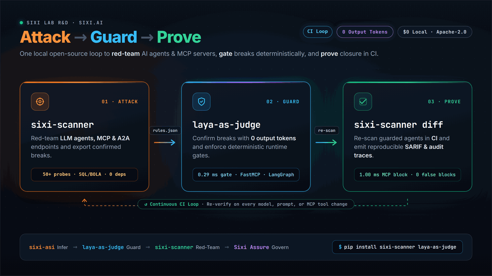
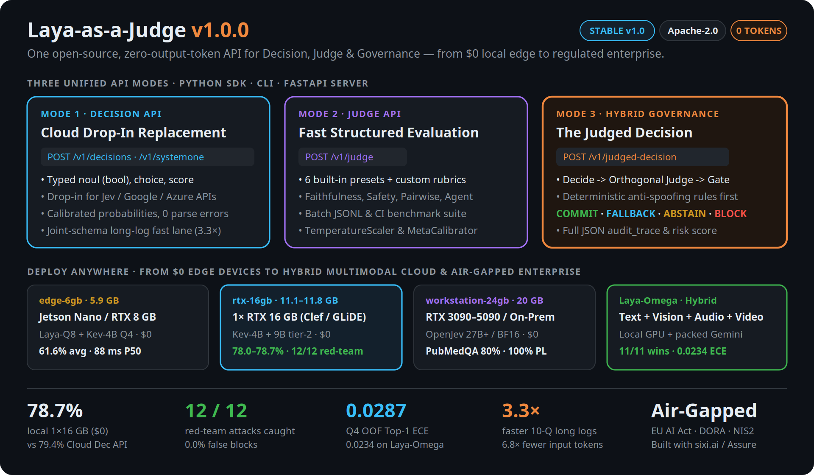

<!-- mcp-name: io.github.radeksixi/laya-as-judge -->

# Laya-as-a-Judge (`v1.2.0`)

[](https://pypi.org/project/laya-as-judge/)
[](https://github.com/radeksixi/laya-as-judge/blob/main/CHANGELOG.md)
[](https://github.com/radeksixi/laya-as-judge/actions)
[](https://huggingface.co/spaces/rbai86/laya-as-judge-demo)
[](https://github.com/radeksixi/laya-as-judge/blob/main/LICENSE)

[](https://radeksixi.github.io/closed-loop-redteam-guard-sixi-scanner-laya-1-2/)

**Zero-output-token Decision, Judge, Drop-In & 4-way `ActionGate` API (`COMMIT / FALLBACK / ABSTAIN / BLOCK`)** — built for both `$0` local GPUs and air-gapped regulated enterprise AI agents ([Sixi Assure](https://sixi.ai/en/assure/)).

[Try Live on HF Space](https://huggingface.co/spaces/rbai86/laya-as-judge-demo) · [PyPI (`pip install laya-as-judge`)](https://pypi.org/project/laya-as-judge/) · [Closed-Loop Write-Up](https://radeksixi.github.io/closed-loop-redteam-guard-sixi-scanner-laya-1-2/) · [RAIL Guard Study](https://radeksixi.github.io/laya-as-judge-1-1-pypi-rail-guard-fastmcp-langgraph/) · [Full Benchmarks & Math (`docs/benchmarks.md`)](https://github.com/radeksixi/laya-as-judge/blob/main/docs/benchmarks.md)

---

## Why CTOs, CISOs & AI Engineering Leads Deploy It

- **For CISOs & AI Risk (Fail-Closed Tool-Call Firewall):** 100% air-gapped on-prem execution (`$0` cloud egress; EU AI Act, FINMA, DORA & GDPR auditability), deterministic anti-spoofing & [`sixi-scanner`](https://github.com/radeksixi/sixi-scanner) regression rules (`0.29 ms` guard overhead, `1.00 ms` MCP rug-pull block), calibrated uncertainty (`ECE 0.029`, explicit `ABSTAIN` instead of guessing), and full JSON `audit_trace`.
- **For CTOs & Platform Teams (`6.7 ms` Drop-In, Zero Lock-In):** Swap URLs without rewriting your stack — drop-in OpenAI `/v1/moderations`, Cohere/vLLM `/v1/rerank`, batched `/v1/decisions/batch` (`7.97×` faster), Prometheus `/metrics`, `0` output tokens, `0%` JSON parse errors, Apache-2.0.
- **For AI Engineering Leads (5-Line Agent Integration):** Native **FastMCP** (`LayaToolGateMiddleware`) and **LangGraph** (`LayaJudgedGateNode`) middleware, stdio MCP server (`uvx laya-as-judge mcp`), A2A v1.0 Agent Card, GitHub Action, and a zero-setup browser playground on [Hugging Face Space](https://huggingface.co/spaces/rbai86/laya-as-judge-demo).

---

## 30-Second Quickstart

```bash
# 1. Try immediately with 0 GB VRAM (heuristic emulator for local dev & CI)
pip install "laya-as-judge[server]"
laya-judge serve --profile emulator --port 8000

# 2. Or deploy 100% air-gapped on 1x 16 GB GPU ($0 cloud, 11.75 GB VRAM)
llama-server -hf ggml-org/Kev-4B-GGUF:Q4_K_M --port 8080 --ctx-size 8192 --parallel 2
llama-server -hf ggml-org/Clef-Flash-GGUF:Q4_K_M --port 8081 --ctx-size 8192 --parallel 2
laya-judge serve --profile rtx-16gb --tier1-url http://127.0.0.1:8080 --tier2-url http://127.0.0.1:8081 --port 8000
```

### 5-Line FastMCP Tool Guard & LangGraph Governance Router

```python
from laya_as_judge import LayaJudgedGateNode, LayaToolGateMiddleware, get_engine, laya_gate_router, make_decision_router

engine = get_engine("systemone", base_url="http://127.0.0.1:8080")
mcp.add_middleware(LayaToolGateMiddleware(engine, high_stakes_tools=["issue_refund", "delete_account"]))
graph.add_conditional_edges("triage", make_decision_router(engine, routes=["billing", "shipping", "security"]))
graph.add_node("governance_gate", LayaJudgedGateNode(engine))
graph.add_conditional_edges("governance_gate", laya_gate_router)  # commit / fallback / abstain / block
```

### Closed `Attack → Guard → Prove` Loop with `sixi-scanner`

```bash
# Attack -> confirm with 0-output-token RedTeamVerdictJudge -> export deterministic guard rules
sixi-scanner scan --url http://agent/v1/chat/completions --stateful \
  --confirm-url http://127.0.0.1:8000/v1/judge --out baseline.json --export-laya guard-rules.json

# Verify 100% regression closure in CI & enforce in runtime
laya-judge verify-sixi guard-rules.json
laya-judge serve --profile rtx-16gb --rules-file guard-rules.json --port 8000
```

---

## Unified API Modes & Drop-In Endpoints



| Interface | Endpoint / Entry | What It Replaces or Enforces | Output Contract |
|---|---|---|---|
| **Decision API** | `POST /v1/decisions`<br>`POST /v1/systemone` | Drop-in local replacement for TypeSafe Jev, Google & Azure Decisions APIs | Typed `noul`, `choice`, `score` + calibrated simplex probabilities (`0` output tokens) |
| **Judge API** | `POST /v1/judge`<br>`laya-judge eval` | 7 presets (`faithfulness`, `safety`, `redteam`, `pairwise`, `trajectory`, ...) + custom rubrics | `passed`, typed `judgements`, Shannon-entropy confidence & latency |
| **Judged Decision** | `POST /v1/judged-decision`<br>`JudgedDecisionEngine` | Decide → Cross-Family Verify → Judge → Deterministic Rules (`--rules-file`) | 4-way `ActionGate` (`COMMIT` / `FALLBACK` / `ABSTAIN` / `BLOCK`) + JSON `audit_trace` |
| **Ecosystem Drop-Ins** | `POST /v1/moderations`<br>`POST /v1/rerank` · `/v1/rank`<br>`GET /metrics` | OpenAI Moderation, Cohere/Jina/vLLM RAG Rerank, Best-of-N verifier & Prometheus metrics | Wire-compatible schemas (`6.7 ms` single decision, `7.97×` batch speedup) |
| **Agent Protocols & CI** | `uvx laya-as-judge mcp`<br>`GET /.well-known/agent-card.json`<br>`uses: radeksixi/laya-as-judge@v1.2.0` | Official MCP Registry stdio server (5 tools), A2A v1.0 endpoint & GitHub Action SARIF gate | JSON-RPC 2.0 / A2A v1.0 / SARIF 2.1.0 |

---

## Verified Production Scoreboard

Every benchmark below is reproducible from scripts in this repository — see **[docs/benchmarks.md](https://github.com/radeksixi/laya-as-judge/blob/main/docs/benchmarks.md)** for full per-benchmark tables, calibration math, and methodology.

| Suite / Scenario | Hardware & Cloud Cost | Measured Result |
|---|---|---|
| **RAIL Guard Benchmark** (`512` real HF cases) | Local `Kev-4B` / `GLiDE-9B` (`$0.00` cloud) | **Pool A `95.0% F1`** (`0.0%` benign FPR) · **Full Pool B (`392/392`): `94.6%` unsafe tool-call intercept** |
| **Closed Security Loop** (`sixi-scanner` ↔ `laya`) | Local `Qwen3.8-27B` + CUDA `Laya` (`$0.00`) | **`2/2` findings closed in `0.29 ms`** (`0/10` benign FPs) · **DVMCP C04 rug-pull blocked in `1.00 ms`** |
| **Local 2-Tier GPU Cascade** (`240` HF questions) | 1× 16 GB RTX (`11.1–11.8 GB` VRAM, `$0.00`) | **`78.0–78.7%` accuracy** (`99.1%` of Cloud Decision API), **`12/12` red-team caught (`0%` FP)**, Q4 ECE `0.070 → 0.029` |
| **Hybrid Multimodal Cascade (`Laya-Omega`)** | Local CUDA + selective Gemini (`2,250` Qs) | **`11 / 11` wins vs. Gemini Decision 1** (`0.0234` 10-fold OOF Top-1 ECE, **`$0.77` total run cost**) |
| **Drop-In Throughput & Latency** | Local `Laya-Q8_0` (`+575 MiB` VRAM, `$0.00`) | **`6.7 ms`** `/v1/decisions`, **`18.2 ms`** `/v1/rank`, **`7.97×`** `/v1/decisions/batch` speedup (`32` items) |

---

## Hardware Profiles & Install Extras

> [!NOTE]
> Plain `pip install laya-as-judge` ships with the zero-weight **`EmulatorBackend`** (`< 1 ms`) so CI pipelines, unit tests, and framework wiring work offline out of the box. Install `[server]` for HTTP/llama.cpp cascades, `[laya]` / `[torch]` for Linux/CUDA neural checkpoints, or `[mlx]` for Apple Silicon (`7–14 ms` on M1–M4).

| Profile / Extra | Footprint | Command |
|---|---|---|
| **Zero-VRAM CI / Dev** | `0 GB` | `pip install "laya-as-judge[server]"` → `laya-judge serve --profile emulator` |
| **Edge / Laptop GPU** | `5.88 GB` VRAM | `laya-judge serve --profile edge-6gb` (Jetson Orin Nano / 8 GB GPU) |
| **Single Workstation GPU** | `11.1–11.8 GB` VRAM | `laya-judge serve --profile rtx-16gb` (or `rtx-16gb-glide`) |
| **Enterprise Node** | `16.8–20.2 GB` VRAM | `laya-judge serve --profile workstation-24gb` |
| **Neural Checkpoints** | `~0.7–1.0 GB` | `pip install "laya-as-judge[torch]"` (CUDA/CPU) or `pip install "laya-as-judge[mlx]"` (macOS) |

---

## Documentation & Links

- **[Full Benchmarks, Math & Code Recipes (`docs/benchmarks.md`)](https://github.com/radeksixi/laya-as-judge/blob/main/docs/benchmarks.md)** — `Laya-Omega` 9-benchmark table, 5 local-GPU experiments, RLCD & Temperature Scaling math, and 7 Python SDK recipes.
- **[Runnable Examples (`examples/`)](https://github.com/radeksixi/laya-as-judge/tree/main/examples)** — FastMCP & LangGraph gates, DecisionBench adapter, local Judged-Decision server, and closed `sixi-scanner` loop.
- **[Changelog (`CHANGELOG.md`)](https://github.com/radeksixi/laya-as-judge/blob/main/CHANGELOG.md)** & **[Contributing (`CONTRIBUTING.md`)](https://github.com/radeksixi/laya-as-judge/blob/main/CONTRIBUTING.md)**.
- **Enterprise AI Governance:** Pairs with **[Sixi Assure](https://sixi.ai/en/assure/)** and **[sixi-scanner](https://github.com/radeksixi/sixi-scanner)** at **[Sixi Lab R&D (`sixi.ai`)](https://sixi.ai)**.

## License & Acknowledgments

Apache License 2.0 — see [LICENSE](https://github.com/radeksixi/laya-as-judge/blob/main/LICENSE). Upstream Laya checkpoints by [Convai Innovations](https://huggingface.co/convaiinnovations/laya); Apple Silicon MLX port by [mizorewww/laya-mlx](https://github.com/mizorewww/laya-mlx). Built by **Radek Brus** ([@radeksixi](https://github.com/radeksixi) · [Sixi Lab R&D](https://sixi.ai)).
